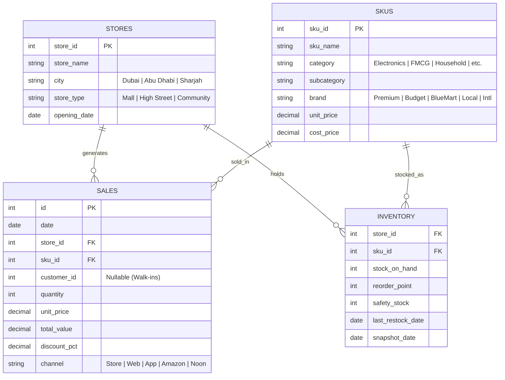
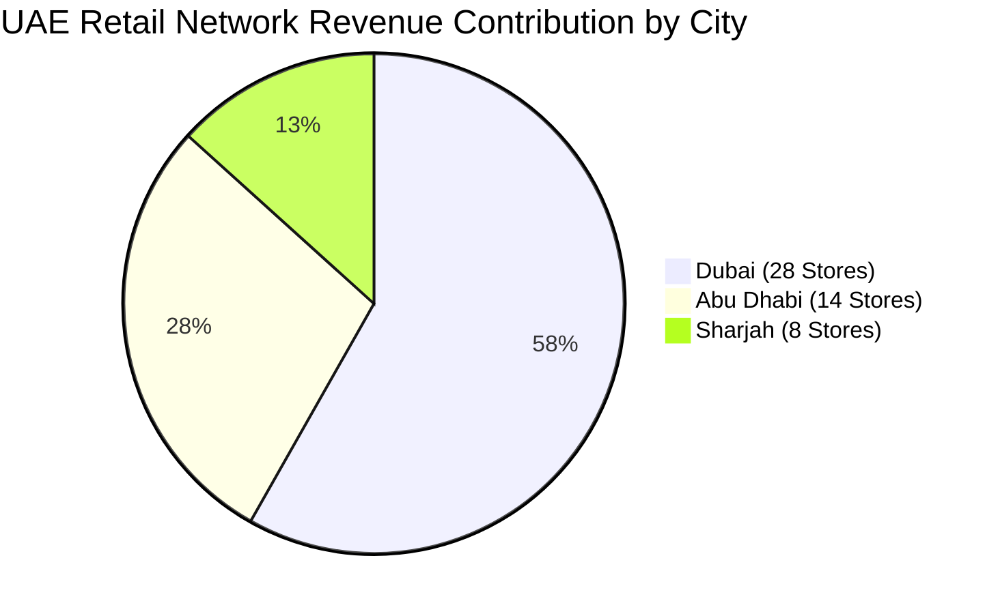

# BlueMart Retail Intelligence | Enterprise BI & Data Analytics Case Study

[](https://retail-bi.priyanshu.cv)
[](https://api-retail-bi.priyanshu.cv/docs)
[](https://github.com/priyanshwho/Retail-Analysis)
[](https://neon.tech)

---

## 1. Executive Summary & Project Overview

**BlueMart Retail Intelligence** is an end-to-end commercial Business Intelligence and Data Science platform developed for a multi-store supermarket chain operating across the United Arab Emirates (**Dubai**, **Abu Dhabi**, and **Sharjah**). 

The primary business objective was to transform **641,843 granular transaction records**, **200 catalog SKUs**, **50 brick-and-mortar retail outlets**, and **8,735 inventory snapshots** into actionable operational intelligence. 

### Key Business Metrics at a Glance
| Metric | Analyzed Value | Business Context |
| :--- | :--- | :--- |
| **Total Commercial Revenue** | **$73,209,783** (~73.2M AED) | Aggregated gross sales across all retail channels |
| **Total Gross Profit** | **$21,097,014** (~21.1M AED) | Net revenue minus Cost of Goods Sold (COGS) |
| **Overall Profit Margin** | **28.82%** | Average profitability ratio across 200 catalog SKUs |
| **Total Units Moved** | **1,677,126 units** | Physical sales volume moved through supply chain |
| **Transaction Volume** | **641,843 orders** | Individual retail basket records |
| **Active Retail Network** | **50 stores in 3 Emirates** | 28 Dubai, 14 Abu Dhabi, 8 Sharjah |
| **Omnichannel Footprint** | **5 Sales Channels** | Physical Stores, Website, Mobile App, Amazon.ae, Noon |

---

## 2. In-Depth Data Science & Exploratory Analysis (`retail-analysis`)

The core analytical engine was engineered inside the [`retail-analysis`](./retail-analysis) module using Python (Pandas, NumPy, Matplotlib, Seaborn). The workflow follows rigorous data analyst methodologies: **Data Quality Auditing**, **Schema Normalization**, **Relational Modeling**, **Management Question Resolution**, and **Ad-Hoc Diagnostic Risk Modeling**.

```
retail-analysis/
├── dataset/
│   ├── bm_sales.csv         # 641,843 sales records (32.7 MB)
│   ├── bm_skus.csv          # 200 catalog product lines with cost & price
│   ├── bm_stores.csv        # 50 retail store locations and formats
│   └── bm_inventory.csv     # 8,735 daily store-SKU stock snapshots
├── Retail.ipynb             # Full Jupyter Notebook with 85 analytical cells
└── pyproject.toml           # Python 3.12 environment specification
```

---

### 2.1 Raw Data Schema & Entities



---

### 2.2 Data Quality Assessment & Hygiene Pipeline

Before running statistical aggregations, a comprehensive quality assessment was executed on the raw transaction tables:

1. **Missing Value Auditing (`.isnull().sum()`)**:
   - `bm_sales.csv`: Missing values were identified solely in `customer_id` (159,821 null values out of 641,843). 
   - *Business Interpretation*: Retail supermarket walk-in shoppers frequently transact via cash/card at POS terminals without registering for membership loyalty cards. These were preserved as valid point-of-sale transactions rather than discarded.
   - `bm_skus.csv`, `bm_stores.csv`, `bm_inventory.csv`: Zero missing attributes (100% complete).
2. **De-duplication (`.drop_duplicates()`)**:
   - 28 duplicate transaction rows were identified and removed, preventing artificial inflation of sales volume.
3. **Temporal Standardization (`pd.to_datetime`)**:
   - Both `sales['date']` and `stores['opening_date']` were coerced from ISO strings to datetime indices to enable vectorized time-series monthly and seasonal aggregations.
4. **Referential Integrity Validation**:
   - Verified that $100\%$ of `store_id` references in sales existed within `bm_stores.csv` (`sdf['store_id'].isin(stdf['store_id']).all() == True`).
   - Verified that $100\%$ of `sku_id` references existed within `bm_skus.csv` (`sdf['sku_id'].isin(pdf['sku_id']).all() == True`).

---

### 2.3 Feature Engineering & Relational Master Merge

Because transactional sales records only track `quantity` and `total_value`, calculating true commercial profitability required joining unit economics from the product catalog:

```python
# Relational Left Joins to synthesize single Analytics-Ready Master Dataset
df = pd.merge(sdf, pdf, on='sku_id', how='left')
df = pd.merge(df, stdf, on='store_id', how='left')

# Feature Engineering Financial Metrics
df['cogs'] = df['quantity'] * df['cost_price']
df['profit'] = df['total_value'] - df['cogs']
df['profit_margin_pct'] = (df['profit'] / df['total_value']) * 100
```

---

## 3. Resolving the 5 Big Management Questions

### Q1: How Are Sales & Revenue Evolving Over Time?
- **Seasonality & Trajectory**: Analyzed monthly sales trends aggregated over a 24-month horizon.
- **Findings**:
  - Stable baseline of **~3.0M to 3.2M AED monthly revenue**.
  - Recurring quarterly spikes coinciding with regional festive periods (Ramadan, Eid, and Q4 Dubai Shopping Festival).
  - Profit trajectory closely mirrors gross sales with a consistent margin band oscillating between **28.2% and 29.4%**, indicating disciplined discounting without catastrophic price erosion.

---

### Q2: Which Merchandise Categories Generate the Highest Sales & Margin?

| Category | Total Sales (AED) | Total Profit (AED) | Profit Margin | Strategic Role |
| :--- | :--- | :--- | :--- | :--- |
| **Electronics** | **40,790,950.89** | **11,848,265.14** | **29.05%** | **Core Revenue & Profit Engine** (55.7% of total revenue) |
| **Household** | **8,190,735.92** | **2,360,418.07** | **28.82%** | High-ticket recurring utility basket driver |
| **Personal Care** | **8,181,799.29** | **2,115,959.34** | **25.86%** | High volume, consistent recurring footfall |
| **Grocery** | **5,564,702.41** | **1,661,022.56** | **29.85%** | Essential daily staple with strong basket attachment |
| **Snacks** | **4,321,275.25** | **1,299,444.11** | **30.07%** | High impulse margin category (>30%) |
| **Dairy** | **4,238,161.64** | **1,237,884.73** | **29.21%** | Perishable, high-frequency velocity driver |
| **Beverages** | **1,922,157.59** | **574,416.61** | **29.88%** | Complementary bundle item |

> **Key Analytical Takeaway**: Electronics alone represents over **55.7% of all retail revenue** and **56.1% of gross profit**. Optimizing electronics supplier contracts and warranty attachments delivers disproportionate bottom-line expansion.

---

### Q3: Which Brands & Products are the Most Profitable?

#### Brand Hierarchy
1. **`Premium`** (#1 Performer):
   - **Sales**: 24.56 Million AED | **Profit**: 7.21 Million AED | **Margin**: **29.36%** | **Units Sold**: 477,247
   - Delivers highest absolute dollar volume.
2. **`Budget`**:
   - **Sales**: 15.24 Million AED | **Profit**: 4.27 Million AED | **Margin**: **28.04%** | **Units Sold**: 360,255
3. **`BlueMart` (Private Label Store Brand)**:
   - **Sales**: 11.28 Million AED | **Profit**: 3.37 Million AED | **Margin**: **29.85%** (Highest margin tier alongside Premium).
   - *Strategic Insight*: Expanding BlueMart private label into Snacks and Household directly increases enterprise margin by avoiding third-party licensing fees.

#### Top 5 Most Profitable Individual SKUs
| SKU Name | Category | Brand | Total Sales (AED) | Total Profit (AED) | Profit Margin |
| :--- | :--- | :--- | :--- | :--- | :--- |
| **`Electronics_Batteries_1035`** | Electronics | Premium | 1,968,289.04 | **768,459.36** | **39.04%** |
| **`Electronics_Mobile Accessories_1174`** | Electronics | Premium | 1,851,457.18 | **689,974.72** | **37.27%** |
| **`Electronics_Cables_1078`** | Electronics | Local | 1,403,360.74 | **552,599.02** | **39.38%** |
| **`Electronics_Cables_1199`** | Electronics | Premium | 1,788,582.29 | **541,907.96** | **30.30%** |
| **`Electronics_Batteries_1173`** | Electronics | Budget | 1,252,212.27 | **511,288.77** | **40.83%** |

---

### Q4: Which Stores, Formats & Cities Perform Best?



- **Top Store**: `BlueMart Store 41` (**1.50M AED** revenue), closely followed by `Store 11` (1.49M) and `Store 49` (1.49M).
- **Format Breakdown**:
  - **Mall Outlets (22 Stores)**: Generate highest average basket size and premium electronics volume.
  - **High Street Outlets (18 Stores)**: Consistent weekday footfall and highest omnichannel delivery dispatch density.
  - **Community Stores (10 Stores)**: Strongest repeat loyalty and highest FMCG/Grocery basket contribution.

---

### Q5: Omnichannel Revenue Contribution

| Channel | Total Revenue (AED) | Share of Revenue | Operational Strategic Insight |
| :--- | :--- | :--- | :--- |
| **Physical Store** | **30,227,603.54** | **41.29%** | Primary anchor, highest margin, zero marketplace commission |
| **Direct Website** | **20,299,836.60** | **27.73%** | High-growth digital storefront with full customer data capture |
| **Mobile App** | **13,097,435.70** | **17.89%** | Highest retention, repeat order frequency, and push notification LTV |
| **Amazon.ae** | **6,470,717.92** | **8.84%** | High volume customer acquisition channel (carries 10-15% platform take rate) |
| **Noon** | **3,114,189.23** | **4.25%** | Regional marketplace presence targeting hyper-local fast delivery |

---

## 4. Advanced Diagnostic & Ad-Hoc Inventory Analysis

Moving beyond descriptive KPIs, the study developed diagnostic models integrating inventory snapshot ledgers (`bm_inventory.csv`):

### 4.1 Stockout Hazard Engine (High Demand / Low Stock)
Identifies catalog items with rapid velocity but dangerous buffer depletion:
$$\text{Hazard Criterion} = \left(\text{sales\_qty} > \text{median}(\text{sales\_qty})\right) \land \left(\text{stock\_on\_hand} < \text{median}(\text{stock\_on\_hand})\right)$$
- **Impact**: Flagged critical SKUs across fast-moving consumable electronics (batteries and charging cables) at risk of stockouts during month-end surges.

### 4.2 Reorder Point Violations (`stock_on_hand < reorder_point`)
- Evaluated daily stock positions against dynamic threshold triggers:
  $$\text{Reorder Trigger} = \text{Lead Time Demand} + \text{Safety Stock}$$
- Identified stores with localized inventory exhaustion despite network-wide surplus, demonstrating the need for **inter-store stock balancing**.

### 4.3 Margin Leakage Detection (High Sales Volume / Low Net Profit)
Flagged catalog products that consume warehouse capacity and shipping bandwidth but contribute sub-optimal margins due to heavy promotions or manufacturer pricing:
$$\text{Margin Leak Criterion} = \left(\text{sales\_value} > \text{median}\right) \land \left(\text{profit} < \text{median}\right)$$
- **Identified Items**:
  - `Dairy_Cream_1015` (Sales: 216.9K | Profit: 53.0K)
  - `Grocery_Canned Goods_1029` (Sales: 221.3K | Profit: 53.2K)
  - `Grocery_Pasta_1196` (Sales: 240.5K | Profit: 56.5K)
  - `Grocery_Rice_1121` (Sales: 252.1K | Profit: 36.2K — margin under 14.3%)
- **Recommendation**: Implement minimum advertised price (MAP) policies and replace low-margin third-party staples with **BlueMart Private Label** alternatives.

---

### 4.4 Pareto 80/20 Distribution Curve
Conducted cumulative ranking of the entire catalog to isolate the "Vital Few" from the "Trivial Many":

```
Cumulative Revenue % = sum(revenue[1..k]) / Total Commercial Revenue
```

- **Result**: Exactly **41 SKUs (20.5% of the catalog)** generate **80.0% of total commercial revenue**.
- **Management Application**: Concentrated inventory priority, supplier SLAs, and premium shelf allocation on these 41 vital revenue drivers while rationalizing slow-moving tail SKUs.

---

## 5. Core Backend Engineering (Architecture & API)

To serve the analytics at interactive sub-second speed, a production REST API was implemented in Python.

### System Architecture
```
FastAPI Router -> Dependency Injection -> SQLAlchemy ORM -> Neon PgBouncer Pool -> Neon PostgreSQL
```

- **Framework**: **FastAPI** (Python 3.12) running under **Uvicorn** with 2 worker processes managed by **PM2** on Oracle Cloud Infrastructure Ubuntu Server.
- **Database**: **Neon Serverless PostgreSQL** hosting 641,843 sales rows, normalized relational indexes on `(store_id, sku_id, date)`.
- **Query Optimization**: High-frequency aggregations (`GROUP BY store_id`, `GROUP BY date`, `SUM(total_value)`) compiled via PostgreSQL CTEs and pooled connections via PgBouncer.
- **CORS & Reverse Proxy**: Reverse-proxied through **Caddy** with automated TLS certificates:
  - Base Endpoint: `https://api-retail-bi.priyanshu.cv/api`
  - Health Endpoint: `/api/health`
  - Analytical Endpoints:
    - `GET /api/overview` — High-level enterprise scorecard & channel split
    - `GET /api/analytics/sales-trend?granularity=month` — Dynamic time-series grouping
    - `GET /api/analytics/stores` — 50-store leaderboard & city comparisons
    - `GET /api/analytics/risk` — Algorithmic stockout & margin leak flags
    - `GET /api/analytics/pareto` — 80/20 cumulative distribution points
    - `GET /api/explorer/sales` — Paginated ledger of 641,000+ individual baskets with column sorting

---

## 6. Core Frontend & Dashboard Experience

Built using modern web technologies focused on executive clarity, zero layout shift, and responsive accessibility:

- **Technology**: **React 19**, **TypeScript**, **Vite 8**, **Tailwind CSS**, **Recharts 3**, **Lucide Icons**.
- **Hosted On**: **Vercel Edge Platform** (`https://retail-bi.priyanshu.cv`).
- **Exact Shape & Size Skeleton Loading**:
  - Zero Layout Shift (CLS = 0) state transitions.
  - Skeletons mirror exact geometric boundaries (KPI cards, composed charts, donut rings, multi-column data tables).
  - Fully adaptive dual-theme palette:
    - **Light Theme**: Soft `#E2ECF5` base with translucent white luminous shimmer.
    - **Dark Theme**: Deep `#1A1F2D` base with subtle indigo/slate sheen.
- **Responsive Layout**: Multi-breakpoint grid collapsing gracefully from 4-column 4K desktop to single-column mobile viewports.
- **Granular Data Explorer**: Full pagination, CSV export capabilities, and multi-dimensional filter bar (Store, Category, City, Date Range).

---

## 7. Business Impact & Strategic Recommendations

1. **Protect the 41 Pareto Drivers**:
   - Establish automated restock triggers for the top 20% SKUs (primarily Premium Electronics).
   - Guarantee 99.5% on-shelf availability to safeguard 80% of top-line revenue.
2. **Eliminate FMCG Margin Leaks**:
   - Re-evaluate promotional discounts on high-velocity, low-profit staples (Rice, Pasta, Canned Goods).
   - Introduce bundle pricing combining high-margin snacks/confectionery with essential grocery staples.
3. **Incentivize Direct Channel Migration**:
   - Marketplace platforms (Amazon.ae & Noon) contribute 13.1% of sales but incur commission fees.
   - Offer loyalty app cash-back rewards to convert third-party marketplace shoppers into direct **BlueMart Mobile App** subscribers.
4. **Inter-Store Inventory Redistribution**:
   - Implement weekly balancing transfers between Dubai hub stores and outlying Sharjah community locations to clear surplus before reorder triggers fire.

---

## 8. Author & Repository Links

- **Author**: Priyanshu
- **Live Production URL**: [https://retail-bi.priyanshu.cv](https://retail-bi.priyanshu.cv)
- **API Documentation**: [https://api-retail-bi.priyanshu.cv/docs](https://api-retail-bi.priyanshu.cv/docs)
- **GitHub Repository**: [https://github.com/priyanshwho/Retail-Analysis](https://github.com/priyanshwho/Retail-Analysis)
- **Jupyter Notebook**: [retail-analysis/Retail.ipynb](./retail-analysis/Retail.ipynb)
